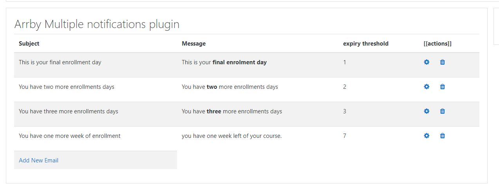
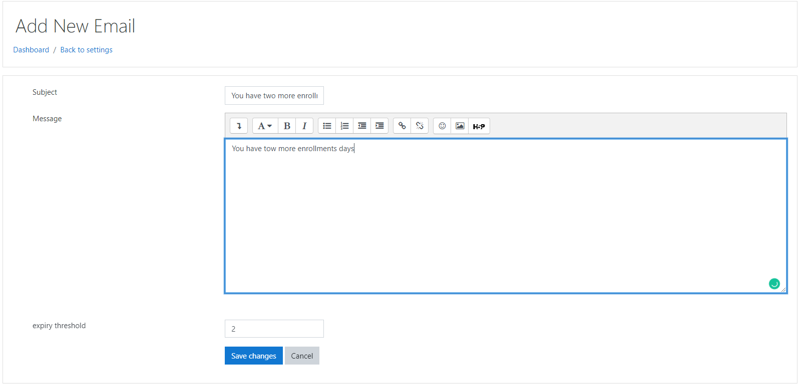

# Moodle Enrollment Expiry Multiple Notifications


A Moodle local plugin that sends **multiple reminder notifications** to enrolled students before their enrollment period expires. Keep your students informed and reduce unexpected enrollment expirations.

## Features

- Send multiple reminder emails before enrollment expiry
- Customizable notification templates with placeholders
- Configure notification timing (days before expiry)
- Support for multiple courses and enrollment methods
- Cron-based automatic notification sending
- Easy-to-use admin interface

## Screenshots

### Plugin Configuration


### Notification Schedule


## Requirements

- Moodle 3.5 or higher
- PHP 7.4 or higher
- Cron properly configured

## Installation

### Via Git (Recommended)

```bash
cd /path/to/moodle/local
git clone https://github.com/harregoces/moodle-local_multiple_notifications.git multiple_notifications
```

### Manual Installation

1. Download the latest release
2. Extract the contents
3. Copy the `multiple_notifications` folder to `/path/to/moodle/local/`
4. Visit Site Administration > Notifications to complete the installation

## Configuration

1. Go to **Site Administration > Plugins > Local plugins > Enrollment Expiry Multiple Notifications**
2. Enable the plugin
3. Configure notification days (e.g., 30, 15, 7, 1 days before expiry)
4. Customize email templates
5. Save changes

## Email Template Placeholders

Use these placeholders in your notification messages:

| Placeholder | Description |
|-------------|-------------|
| `[firstname]` | Student's first name |
| `[lastname]` | Student's last name |
| `[coursename]` | Name of the course |
| `[timeend]` | Enrollment end date/time |
| `[timestart]` | Enrollment start date/time |
| `[time]` | Current date/time |

### Example Template

```
Dear [firstname] [lastname],

Your enrollment in "[coursename]" will expire on [timeend].

Please renew your enrollment to continue accessing the course materials.

Best regards,
The Learning Team
```

## How It Works

1. The plugin runs via Moodle's scheduled tasks (cron)
2. It checks all enrollments with upcoming expiry dates
3. Based on your configured notification days, it sends reminder emails
4. Students receive personalized notifications with course details

## Contributing

Contributions are welcome! Please feel free to submit a Pull Request.

1. Fork the repository
2. Create your feature branch (`git checkout -b feature/AmazingFeature`)
3. Commit your changes (`git commit -m 'Add some AmazingFeature'`)
4. Push to the branch (`git push origin feature/AmazingFeature`)
5. Open a Pull Request

## Author

**Hernan Arregoces** - Software Engineer specialized in Moodle Development

- [Moodle Profile](https://moodle.org/user/profile.php?id=1931915)
- [LinkedIn](https://www.linkedin.com/in/hernanarregoces/)
- [GitHub](https://github.com/harregoces)

## License

This project is licensed under the GPL-3.0 License - see the [LICENSE](LICENSE) file for details.

## Support

If you find this plugin useful, consider giving it a star on GitHub!

---

Made with love for the Moodle community
